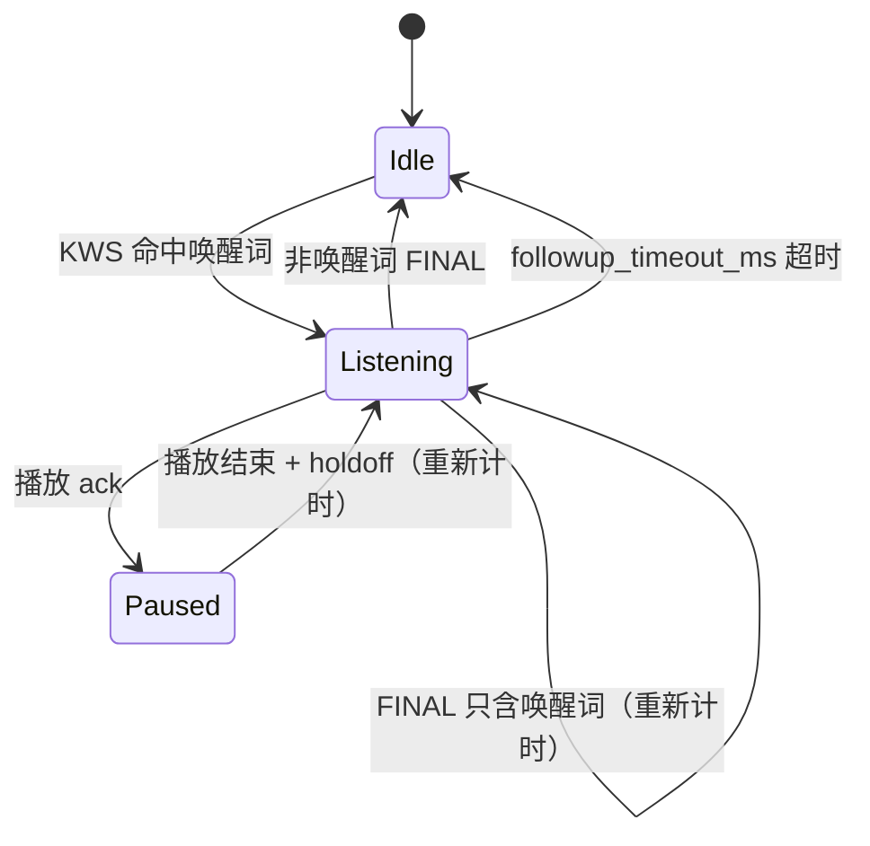

# asr 功能包设计与架构

> 对象：`microduck_rev` 的 `asr` 功能包
> 状态：已实现可切换后端（SenseVoice / KWS）和常开唤醒词阶段
> 上游：[`../../docs/duck-ros2-asr-architecture.zh-CN.md`](../../../docs/duck-ros2-asr-architecture.zh-CN.md)
> 相关包：`audio_io`、`audio_io_interface`、`asr_interface`、`common_cpp`

---

## 1. 目标与边界

`asr` 负责把 `audio_io` 的麦克风 PCM 变成识别事件，并把“是否开始识别”的会话门控留在本包：

```text
audio_io/capture → AsrNode → AsrBackend → AsrEvent
```

负责：

- 订阅 `/audio_io/capture`，不打开 ALSA；
- 下混、重采样到 16 kHz mono；
- 采集回调与推理线程解耦的有界队列；
- 播放门控：机器人自己说话时暂停识别；
- 可切换 ASR 后端；
- 常开唤醒词、pre-roll、唤醒后识别窗口、超时；
- 发布 `AsrEvent` / `AsrState`。

不负责：

- 唤醒词的具体内容（由 `duck_asr` 提供的 `wake.keywords_file` 决定）；
- 鸭子口令语义（“电量”“站起来”）；
- TTS 回复“我在”（`duck_asr` 的策略）；
- 麦克风设备、播放、音库、舵机。

---

## 2. 包结构

```text
src/asr/
├── include/asr/
│   ├── asr_node.hpp
│   ├── asr_backend.hpp
│   ├── backend_factory.hpp
│   ├── sense_voice_backend.hpp
│   ├── sense_voice_recognizer.hpp
│   ├── vad_segmenter.hpp
│   ├── keyword_backend.hpp
│   ├── keyword_wake_detector.hpp
│   ├── wake_word_detector.hpp
│   ├── linear_resampler.hpp
│   └── path_utils.hpp
├── src/
│   ├── asr_node.cpp
│   ├── backend_factory.cpp
│   ├── sense_voice_backend.cpp
│   ├── sense_voice_recognizer.cpp
│   ├── vad_segmenter.cpp
│   ├── keyword_backend.cpp
│   ├── keyword_wake_detector.cpp
│   ├── linear_resampler.cpp
│   └── main.cpp
├── config/asr.yaml
├── launch/asr.launch.py
├── tools/replay_capture.py
├── test/
└── docs/
```

Target：

| target | 类型 | 说明 |
|---|---|---|
| `asr` | `libasr.so` | `AsrNode`、后端接口/工厂、所有后端、重采样 |
| `asr_node` | executable | 只做 `main()`、执行器、`common_cpp` 日志桥接 |

---

## 3. 节点结构

`AsrNode` 是组合式节点，不继承 `rclcpp::Node`：

```cpp
auto node = std::make_shared<rclcpp::Node>("duck_asr");
auto asr = std::make_shared<asr::AsrNode>(node);
asr->start();
```

内部结构：

```text
AsrNode (rclcpp::Node + worker thread)
├── capture subscription  ~/capture (audio_io)
├── audio_io event       (播放门控)
├── event publisher      ~/event
├── state publisher      ~/state
├── state timer
├── capture queue        bounded by queue.max_ms
├── LinearResampler      any rate → 16 kHz
├── WakeWordDetector     optional, always-on KWS
└── AsrBackend           selected by backend
```

关键约束：

- 采集回调只校验、拷贝并入队；不在回调里跑 VAD/ASR；
- 所有后端推理都在单工作线程串行执行；
- 麦克风唯一所有者仍是 `audio_io`；
- 后端初始化失败只影响识别，不退出节点。

---

## 4. 后端接口

`include/asr/asr_backend.hpp`：

```cpp
struct BackendEvent {
    BackendEventType type;  // SpeechStart / Endpoint / Partial / Final / Failed
    std::string text;
    std::string language;
    std::string error;
    float confidence;
};

class AsrBackend {
    virtual std::string_view name() const noexcept = 0;
    virtual bool initialize(std::string* error) = 0;
    virtual bool ok() const = 0;
    virtual std::vector<BackendEvent> push(const float* samples, std::size_t count) = 0;
    virtual std::vector<BackendEvent> flush() = 0;
    virtual void reset() = 0;
};
```

`AsrNode` 只调用这四个操作，不包含任何具体模型字段。

### 4.1 `sense_voice`

```text
16k PCM → silero VAD → 完整语音段 → SenseVoice → 文本
```

- 事件：`SpeechStart` → `Endpoint` → `Final`；
- 适合完整转写；
- 模型：`recognizer.*` + `vad.*`。

### 4.2 `keyword`

```text
16k PCM → sherpa-onnx KeywordSpotter → 命中的关键词
```

- 事件：`Final`（text=关键词）；
- 无 VAD、无 SenseVoice；
- 适合固定词/轻量场景；
- 模型：`keyword.*`，关键词：`keyword.keywords_file`。

### 4.3 工厂

`backend_factory.cpp` 根据 `backend` 参数创建后端并读取该后端的参数：

```text
backend: sense_voice | keyword
```

新增后端：

1. 实现 `AsrBackend`；
2. 在 `backend_factory.cpp` 增加分支；
3. 增加参数和测试。

AsrNode 不需要修改。

---

## 5. 唤醒词设计

### 5.1 职责

唤醒词机制放在 `asr`，因为它是音频会话门控，不是鸭子语义：

| 能力 | `asr` | `duck_asr` |
|---|---|---|
| 常开 KWS | ✅ | ❌ |
| pre-roll / 识别窗口 / 超时 | ✅ | ❌ |
| 主 ASR | ✅ | ❌ |
| “小鸭小鸭”具体词表 | 接收文件 | ✅ 提供 |
| “我在”反馈 | ❌ | ✅ |
| 电量/姿势意图 | ❌ | ✅ |

### 5.2 组件

```text
WakeWordDetector
  └── KeywordWakeDetector
        └── 复用 KeywordBackend 的 KWS 解码
```

`wake.keywords_file` 是独立文件；KWS 模型复用 `keyword.encoder/decoder/joiner/tokens`。
`KeywordWakeDetector` 同时读取 `keywords.txt` 中 `@` 后的显示词，供“只识别到唤醒词”过滤。

### 5.3 状态机



### 5.4 两种交互

**一次说完**

```text
用户：小鸭小鸭，当前电量是多少
KWS：EVENT_WAKE
asr：pre-roll + 后续音频送主 ASR
duck_asr：ack 延迟内收到 SPEECH_START → 取消“我在”
asr：EVENT_FINAL
```

- 唤醒后立即打开窗口；
- `pre_roll_ms` 保留唤醒词之前的音频，避免命令开头被 KWS 延迟切掉；
- `duck_asr` 需要去除 ASR 文本里的唤醒前缀。

**分两次说**

```text
用户：小鸭小鸭
KWS：EVENT_WAKE
duck_asr：延迟后播放“我在”
audio_io：播放门控
asr：暂停会话（不取消）
播放结束：重新计时 followup_timeout_ms
用户：当前电量是多少
asr：EVENT_FINAL
```

- 播放门控期间不取消唤醒会话；
- 播放结束后重置 backend、清空 pre-roll、重新开始超时；
- 只识别到唤醒词的 final 不结束会话；
- `followup_timeout_ms` 到期发 `EVENT_CANCELED`。

**ack 的前提**：如果 `duck_asr` 每次唤醒都立即播放“我在”，一次说完的命令会被播放门控挡住。
ack 必须“延迟 + 可取消”，或者需要 AEC/全双工。ack 的内容和延迟属于 `duck_asr`。

### 5.5 唤醒参数

| 参数 | 默认 | 说明 |
|---|---|---|
| `wake.enabled` | `false` | 启用常开唤醒 |
| `wake.keywords_file` | 空 | 唤醒词表；`@` 后为显示词 |
| `wake.pre_roll_ms` | `1000` | 唤醒前保留音频 |
| `wake.followup_timeout_ms` | `6000` | 唤醒后等待命令 |

唤醒 KWS 的模型参数在 `keyword.*`。

---

## 6. 事件与状态

### 6.1 `AsrEvent`

| 事件 | 来源 | 语义 |
|---|---|---|
| `EVENT_WAKE` | 唤醒阶段 | 命中 `wake.keywords_file`，text=显示词 |
| `EVENT_SPEECH_START` | 唤醒/主 ASR | 会话开始 |
| `EVENT_PARTIAL` | 后端可选 | 中间结果，当前内置后端不发 |
| `EVENT_ENDPOINT` | SenseVoice | 句尾 |
| `EVENT_FINAL` | 主 ASR | 最终文本 |
| `EVENT_FAILED` | 后端 | 失败，error 英文原因 |
| `EVENT_CANCELED` | 门控/超时 | 会话取消 |

事件是边沿，不是电平。一次唤醒只发一次 `EVENT_WAKE`；一次命令只发一次 `EVENT_FINAL`。

### 6.2 `AsrState`

- `backend`：主后端名称；
- `model_loaded`：主后端模型是否加载；
- `mode`：`free_asr` / `wake_command` / `wake_error`；
- `gated`：当前是否因播放静音；
- `session_active`：是否有唤醒会话；
- `audio_gap_count`：采集序号缺口；
- `last_error`：最近错误。

---

## 7. 线程、队列与门控

```text
audio_io capture (10 ms)
  → on_capture：校验 + 入有界队列
  → worker：重采样 → KWS / backend
  → publish event
```

- 队列按毫秒预算（`queue.max_ms`），溢出丢最旧块；
- 采集序号跳变时清空队列、重置后端、`audio_gap_count++`；
- 播放事件：
  - 普通状态：取消当前会话；
  - 唤醒窗口内：暂停会话，不取消；播放结束后恢复并重新计时；
- 门控兜底 `gate.max_ms`，避免事件丢失导致永久静音。

---

## 8. 参数

完整默认值见 [`../config/asr.yaml`](../config/asr.yaml)。

| 参数 | 说明 |
|---|---|
| `backend` | `sense_voice` / `keyword` |
| `wake.*` | 唤醒开关、词表、pre-roll、follow-up |
| `keyword.*` | KWS 模型、关键词文件、阈值 |
| `vad.*` | silero VAD（SenseVoice） |
| `recognizer.*` | SenseVoice 模型、语言、线程 |
| `capture.stream_id` | 只接受的采集流 |
| `gate.*` | 播放门控 |
| `queue.max_ms` | 采集队列预算 |
| `state.period_ms` | 状态发布周期 |

`audio_io` 的节点名和话题由 `audio_io_interface` 的 helper 结合当前 namespace 生成，不通过参数配置。

---

## 9. 失败模式

| 失败 | 行为 |
|---|---|
| 主后端模型缺失/初始化失败 | 节点继续运行，`model_loaded=false`，`last_error` 说明原因 |
| 唤醒模型/词表缺失 | `wake.enabled=true` 时 `mode=wake_error`，不识别；不退出节点 |
| 唤醒 KWS 未命中 | 主 ASR 不运行，只维护 pre-roll |
| 只识别到唤醒词 | 不结束会话，继续等待 follow-up |
| 唤醒后超时 | `EVENT_CANCELED`，回到 Idle |
| 播放门控 | 暂停识别；唤醒窗口内只暂停不取消 |
| 采集格式错误 | 丢帧，只告警一次 |
| 下游无订阅者 | 事件丢弃，不阻塞工作线程 |

---

## 10. 构建与测试

```bash
source /opt/ros/humble/setup.bash
export SHERPA_ONNX_ROOT=/opt/sherpa-onnx
colcon build --base-paths src --packages-select asr \
  --cmake-args -DSHERPA_ONNX_ROOT=/opt/sherpa-onnx \
  -DCMAKE_CXX_COMPILER=g++-13 -DCMAKE_C_COMPILER=gcc-13
```

测试：

```bash
colcon test --packages-select asr
colcon test-result --test-result-base build/asr/test_results --verbose
```

模型测试通过 `ASR_SENSE_VOICE_*`、`ASR_VAD_MODEL`、`ASR_TEST_WAV`、`ASR_KWS_*` 环境变量启用；
没有模型时相关测试 `GTEST_SKIP`。

回放工具：

```bash
python3 install/asr/share/asr/tools/replay_capture.py /path/to/test.wav
```

---

## 11. 扩展点

### 新增主后端

实现 `AsrBackend`，在 `backend_factory.cpp` 增加分支；AsrNode 不需要改。

### 新增唤醒检测器

实现 `WakeWordDetector`，在 `create_wake_word_detector()` 中替换/增加工厂分支；主 ASR 和会话逻辑不变。

### 后续

- 唤醒后“我在”的 ack 延迟/取消在 `duck_asr` 实现；
- 词表约束、`EVENT_PARTIAL`、`~/enable`、`~/listen` 尚未实现；
- 若需要非 sherpa 后端且完全不链接 sherpa，需要把后端拆成可选库或插件。
